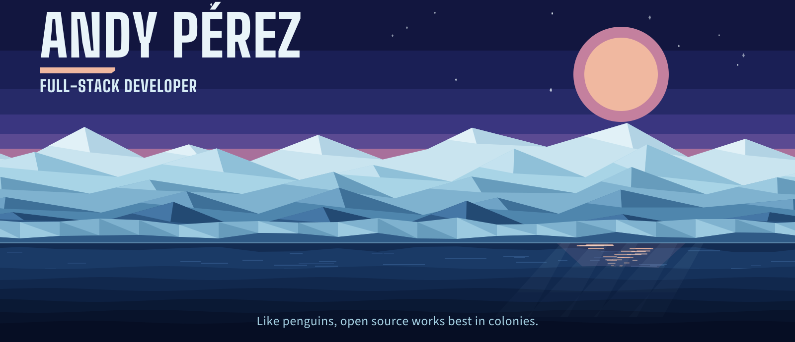

  
<pre>
    •••••
    ¡Bienvenido/a a mi repositorio de personal. 
    Aquí voy subiendo mis proyectos personales, 
    inventos de fin de semana y 
    pequeñas chorradas para pasar el rato.
    •••••
</pre>
 
<i>"Like penguins, open source works best in colonies."</i>
  

<!--

 -->

  
  

  
  

